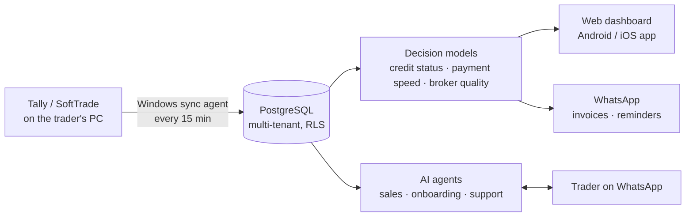

# Vikas Agarwal

Lead AI Engineer and Engineering Manager at FieldAssist. Founder of **[OpenBahi](https://openbahi.com)**, an AI product for wholesale traders that I built solo and run.

I like problems that start as "this is costing us money" and end as a system running in production. Jaipur, India.

cw.vikas@gmail.com

---

## OpenBahi: AI agents for wholesale traders

Traders in India keep their books in Tally or SoftTrade and still decide on gut feel whom to chase for money and whom to stop selling to on credit. OpenBahi reads the books, makes those calls, and acts on them over WhatsApp.

**Live since September 2026 with 13 trading firms in Rajasthan:** ₹1,500 Cr of sales across 1.78 lakh invoices, ~20,000 customer accounts scored for credit and payment speed.

  

  

*Screens from the demo company; no real client data.*

**What the AI agents do**

- **Sales:** every lead from a Meta ad gets a WhatsApp conversation that qualifies the trader from an approved fact sheet and moves them to sign-up. I step in only on hand-off.
- **Onboarding:** a coach walks each new firm through installing the sync agent and connecting their books until the first sync lands.
- **Support:** owners ask about their books in Hindi or English and get an answer with the ledger or invoice PDF. Every figure is checked against the books before it's sent.

**Engineering notes**

- Runs unattended: the sync agent on client PCs has had 12 releases, each with a one-line rollback and never a reinstall.
- The credit model replaced letter grades with five statuses backtested on 7 years of each firm's own books. Customers flagged "Recover" stalled 73% of the time vs 2% for "OK".
- Every prompt or tool change is gated by a regression bench. Prompts, tools and facts carry version labels.
- Built solo with an AI-agent workflow: spec → plan → agent-implemented tasks → two reviews each. 6,600+ automated tests.
- Stack: Python, TypeScript/Deno edge functions, PostgreSQL (Supabase), Cloudflare Pages, Capacitor, WhatsApp Business Platform, GitHub Actions.

The code is private because it carries client data paths and deployment config. I'm happy to walk through any part of it in an interview.

---

## At FieldAssist

AI and data engineering for a field-sales platform with 100K+ users and 1.5M+ daily transactions. Shipped an agent-driven integration platform (500+ workflows, 50M+ records a day), a self-service analytics layer over a 2 TB warehouse, and the LLM evaluation harness that gates both.

---

## Public repos worth a look

- **[pulse-ai](https://github.com/vickyvicus/pulse-ai)**: natural-language questions to SQL insights over sales data, FastAPI + LangGraph.
- **[support-ticket-intelligence-ml](https://github.com/vickyvicus/support-ticket-intelligence-ml)**: priority, escalation and resolution-time prediction on support tickets.
- **[openbahi-downloads](https://github.com/vickyvicus/openbahi-downloads)**: the public installer channel for OpenBahi.
