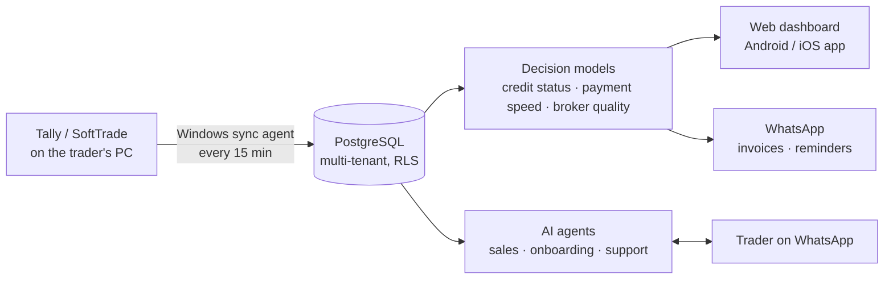
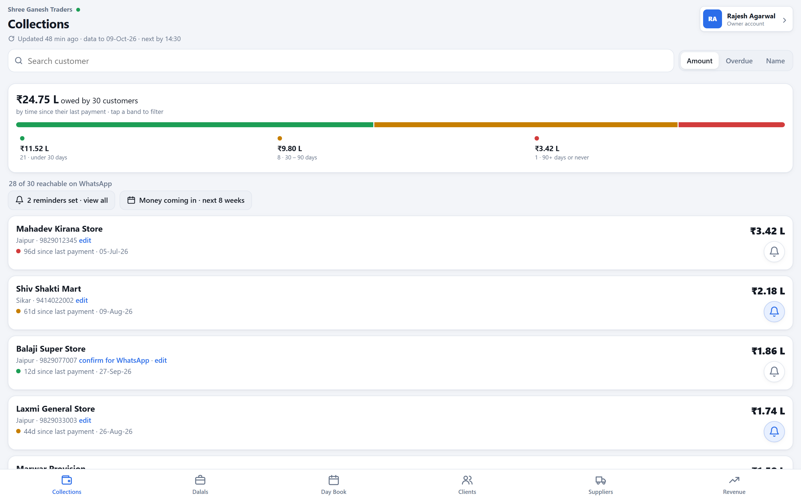
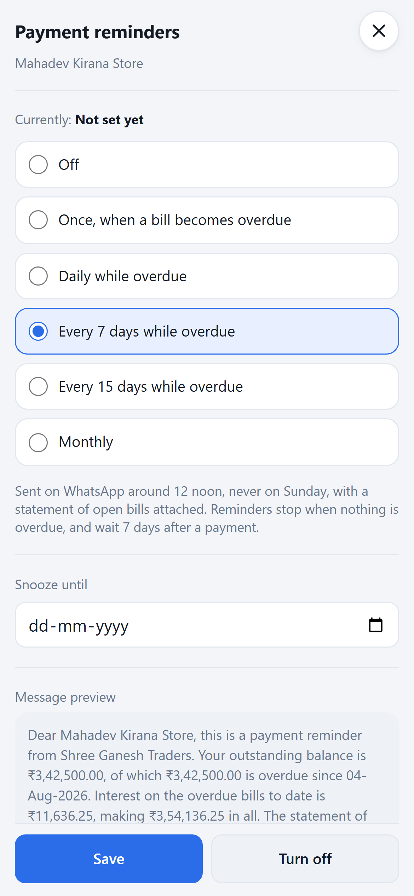

# Vikas Agarwal

Lead AI Engineer and Engineering Manager at FieldAssist. Founder of **[OpenBahi](https://openbahi.com)**, an AI product for wholesale traders that I built solo and run.

I like problems that start as "this is costing us money" and end as a system running in production. Jaipur, India.

cw.vikas@gmail.com

---

## OpenBahi: AI agents for wholesale traders

Traders in India keep their books in Tally or SoftTrade and still decide on gut feel whom to chase for money and whom to stop selling to on credit. OpenBahi reads the books, makes those calls, and acts on them over WhatsApp.

**Live since September 2026 with 13 trading firms in Rajasthan:** ₹1,500 Cr of sales across 1.78 lakh invoices, ~20,000 customer accounts scored for credit and payment speed.

  

  

*Screens from the demo company; no real client data.*

**What the AI agents do**

- **Sales:** every lead from a Meta ad gets a WhatsApp conversation that qualifies the trader from an approved fact sheet and moves them to sign-up. I step in only on hand-off.
- **Onboarding:** a coach walks each new firm through installing the sync agent and connecting their books until the first sync lands.
- **Support:** owners ask about their books in Hindi or English and get an answer with the ledger or invoice PDF. Every figure is checked against the books before it's sent.

**Engineering notes**

- Runs unattended: the sync agent on client PCs has had 12 releases, each with a one-line rollback and never a reinstall.
- The credit model replaced letter grades with five statuses backtested on 7 years of each firm's own books. Customers flagged "Recover" stalled 73% of the time vs 2% for "OK".
- Every prompt or tool change is gated by a regression bench. Prompts, tools and facts carry version labels.
- Built solo with an AI-agent workflow: spec → plan → agent-implemented tasks → two reviews each. 6,600+ automated tests.
- Stack: Python, TypeScript/Deno edge functions, PostgreSQL (Supabase), Cloudflare Pages, Capacitor, WhatsApp Business Platform, GitHub Actions.

The code is private because it carries client data paths and deployment config. I'm happy to walk through any part of it in an interview.

---

## At FieldAssist (Sep 2020 – present)

**Lead AI Engineer & Engineering Manager.** FieldAssist runs field sales for FMCG brands: 100K+ field users and 1.5M+ transactions a day at a 99% SLA. I own AI and data engineering and lead a team of 8.

**Problems I took on**

- **Each integration cost ₹75K and 15 days from a vendor.** I built an agent-driven platform: users describe the source, destination and transformation in plain language, and an orchestrator agent builds and deploys the workflow. 500+ integrations in the first year, each in minutes. It now runs 500+ workflows at 150+ executions/sec over 50M+ records a day.
- **Business users waited 3–4 days for a report.** Self-service analytics now lets them ask in plain language over a 2 TB star-schema warehouse. A LangGraph pipeline validates the question, picks the right business view, writes SQL on Trino and formats the answer; retrieval over the schema has guards against made-up columns and joins. Reports take 1–2 hours.
- **Nobody could say whether the AI was right.** I made evaluation a release gate:
  - an LLM judge scoring answers on a versioned rubric
  - a golden question set reviewed by domain experts
  - retrieval measured on precision, recall and F1
  - the judge checked against human labels (Cohen's κ)
  - a regression run before every deploy, with per-call cost and latency tracked
- **Revenue drops at outlets surfaced only at month-end.** I built anomaly detection on ClickHouse with incremental loads and explicit confidence levels, so thin-data outlets get flagged rather than misjudged.
- **100+ bulk-upload types were stuck in a legacy ASP.NET monolith.** I led an agent-assisted migration to .NET 9, signed off by a harness that replayed real production jobs through both systems: 100% behavioural parity before cutover.
- **Scaling the core:** sharding, partitioning, federation and geo-redundant replication on a 2 TB database.

**Before FieldAssist:** early engineer at Workozy / FA-Flo, a startup with a team of 6, where we grew MRR 5× (₹3L → ₹15L) and onboarded Star TV and Pidilite. Before that, Cognizant (Potential Orbit Shifter program, Diamond in the Rough award).

---

## Public repos worth a look

- **[pulse-ai](https://github.com/vickyvicus/pulse-ai)**: natural-language questions to SQL insights over sales data, FastAPI + LangGraph.
- **[support-ticket-intelligence-ml](https://github.com/vickyvicus/support-ticket-intelligence-ml)**: priority, escalation and resolution-time prediction on support tickets.
- **[openbahi-downloads](https://github.com/vickyvicus/openbahi-downloads)**: the public installer channel for OpenBahi.
